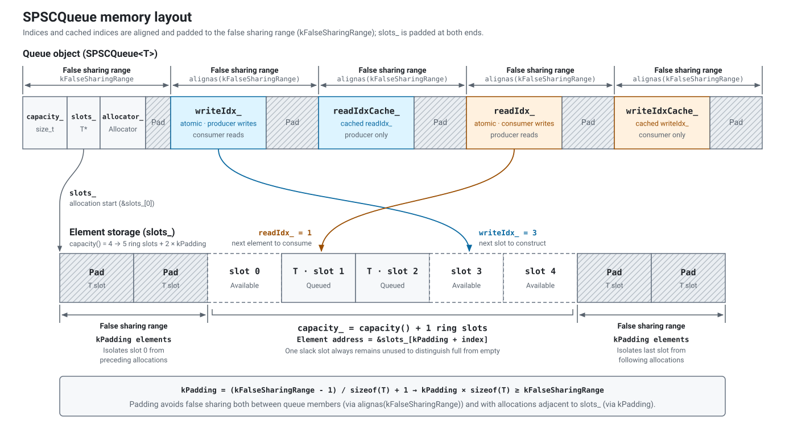

# SPSCQueue.h

A single-header, wait-free single-producer single-consumer queue written in
C++20.

Why choose `SPSCQueue`:

- **Fast under real workloads**: leads all tested queues in bounded throughput
  (`219.3 Mops/s`) with `86–91 ns` warm round-trip latency (faster than
  `boost::lockfree::spsc_queue`, `folly::ProducerConsumerQueue`,
  `moodycamel::ReaderWriterQueue`, `dro::SPSCQueue`, and `DPDK rte_ring`).
- **No artificial type or capacity restrictions**: supports
  non-default-constructible and immovable types, arbitrary non-power-of-two
  capacities, custom allocators (including `allocate_at_least`), and zero-copy
  consumption (`front()`/`pop()`, `try_consume()`).
- **Drop-in and rigorously verified**: single header with no external
  dependencies, 100% MC/DC test coverage, and bounded RC11 weak-memory
  verification with GenMC.

## Example

The producer sends 100 integers. The consumer adds them and prints `5050`:

```cpp
rigtorp::SPSCQueue<int> queue(16);
constexpr int count = 100;

auto consumer = std::thread([&] {
  int sum = 0;
  for (int i = 0; i < count; ++i) {
    int value;
    while (!queue.try_pop(value)) {
      std::this_thread::yield();
    }
    sum += value;
  }
  std::cout << sum << '\n';
});

for (int i = 1; i <= count; ++i) {
  queue.push(i);
}

consumer.join();
```

See [SPSCQueueExample.cpp](src/SPSCQueueExample.cpp) for the full example.

Use `try_consume` to process an item in place, without copying or moving it:

```cpp
SPSCQueue<int> q(1);
q.push(42);
if (q.try_consume([](int &value) { std::cout << value << std::endl; })) {
  // The item has been destroyed and removed from the queue.
}
```

## Usage

Use one producer thread to add items and one consumer thread to remove them.
These threads can run at the same time. Stop all access before you destroy the
queue.

`T` must have a destructor that does not throw. The queue cannot be copied or
moved. C++20 constraints reject operations that the element type does not support.

- `SPSCQueue<T, Allocator>(capacity, allocator)`

  Allocate storage. The allocator argument is optional. Zero capacity becomes one.

- `emplace(args...)`

  Construct an item in place. Spin while full.

- `push(value)`

  Copy or move an item into the queue. Spin while full.

- `try_emplace(args...)`, `try_push(value)`

  Add an item. Return `false` if full, without copying or moving the arguments.

- `try_pop(value)`

  Assign the front item to `value`, then remove it. Return `false` if empty;
  leave `value` unchanged.

- `try_consume(fn)`

  Call `fn` with a reference to the front item, then remove it. Return `false`
  if empty; do not call `fn`.

- `front()`

  Return a pointer to the front item, or `nullptr` if empty.

- `pop()`

  Remove the front item. First call `front()` and check for a non-null pointer.

- `size()`, `empty()`

  Read the queue state from any thread. Results can become stale during
  concurrent use. Frequent polling reduces queue performance.

- `capacity()`

  Return the actual capacity. This value does not change.

Successful `try_` operations return `true`. They do not wait for data or space.
`try_pop` uses move assignment if available, or copy assignment otherwise.
`try_consume` supports items that cannot be copied or moved.

A pointer from `front()` is valid until that item is removed or the queue is
destroyed. Do not remove the item between `front()` and `pop()`. A callback must
not consume from the same queue, destroy it, or use the item after removal.

If construction throws, no item is added. If assignment or a callback throws,
the item stays in the queue. These operations can still change their arguments
or the item. Retrying a callback can repeat its effects.

Any thread can call `size()`, `empty()`, or `capacity()` while the queue is alive.
`size()` and `empty()` do not give a consistent snapshot during concurrent use.
Use `try_` operations to check whether an item was added or removed.

The allocator controls storage only, not element construction or destruction.
It can increase capacity through `allocate_at_least`. Excessive requested
capacities are reduced to leave room for internal storage; allocation can fail.

See [SPSCQueue.h](include/rigtorp/SPSCQueue.h) for full type requirements and
exception contracts.

## Huge page support

In addition to supporting custom allocation through the [standard custom
allocator interface](https://en.cppreference.com/w/cpp/named_req/Allocator) this
library also supports standard proposal [P0401R3 Providing size feedback in the
Allocator
interface](http://www.open-std.org/jtc1/sc22/wg21/docs/papers/2020/p0401r3.html).
This allows convenient use of [huge
pages](https://www.kernel.org/doc/html/latest/admin-guide/mm/hugetlbpage.html)
without wasting any allocated space. Size feedback is used when the allocator
provides `allocate_at_least`.

The library currently doesn't include a huge page allocator since the APIs for
allocating huge pages are platform dependent and handling of huge page size and
NUMA awareness is application specific.

Below is an example huge page allocator for Linux:

```cpp
#include <sys/mman.h>

template <typename T> struct Allocator {
  using value_type = T;

  struct AllocationResult {
    T *ptr;
    size_t count;
  };

  size_t roundup(size_t n) { return (((n - 1) >> 21) + 1) << 21; }

  AllocationResult allocate_at_least(size_t n) {
    size_t count = roundup(sizeof(T) * n);
    auto p = static_cast<T *>(mmap(nullptr, count, PROT_READ | PROT_WRITE,
                                   MAP_PRIVATE | MAP_ANONYMOUS | MAP_HUGETLB,
                                   -1, 0));
    if (p == MAP_FAILED) {
      throw std::bad_alloc();
    }
    return {p, count / sizeof(T)};
  }

  void deallocate(T *p, size_t n) { munmap(p, roundup(sizeof(T) * n)); }
};
```

See `src/SPSCQueueExampleHugepages.cpp` for the full example on how to use huge
pages on Linux.

## Implementation



The underlying implementation is based on a [ring
buffer](https://en.wikipedia.org/wiki/Circular_buffer).

Care has been taken to make sure to avoid any issues with [false
sharing](https://en.wikipedia.org/wiki/False_sharing). The head and tail indices
are aligned and padded to the false sharing range (cache line size).
Additionally the slots buffer is padded with the false sharing range at the
beginning and end, this prevents false sharing with any adjacent allocations.

This implementation has higher throughput than a typical concurrent ring buffer
by locally caching the head and tail indices in the writer and reader
respectively. The caching increases throughput by reducing the amount of cache
coherency traffic.

To understand how that works first consider a read operation in absence of
caching: the head index (read index) needs to be updated and thus that cache
line is loaded into the L1 cache in exclusive state. The tail (write index)
needs to be read in order to check that the queue is not empty and is thus
loaded into the L1 cache in shared state. Since a queue write operation needs to
read the head index it's likely that a write operation requires some cache
coherency traffic to bring the head index cache line back into exclusive state.
In the worst case there will be one cache line transition from shared to
exclusive for every read and write operation.

Next consider a queue reader that caches the tail index: if the cached tail
index indicates that the queue is empty, then load the tail index into the
cached tail index. If the queue was non-empty multiple read operations up until
the cached tail index can complete without stealing the writer's tail index
cache line's exclusive state. Cache coherency traffic is therefore reduced. An
analogous argument can be made for the queue write operation.

This implementation allows for arbitrary non-power of two capacities, instead
allocating a extra queue slot to indicate full queue. If you don't want to waste
storage for a extra queue slot you should use a different implementation.

References:

- *Intel*. [Avoiding and Identifying False Sharing Among Threads](https://software.intel.com/en-us/articles/avoiding-and-identifying-false-sharing-among-threads).
- *Wikipedia*. [Ring buffer](https://en.wikipedia.org/wiki/Circular_buffer).
- *Wikipedia*. [False sharing](https://en.wikipedia.org/wiki/False_sharing).

## Testing

Testing lock-free algorithms is hard. This repository combines several
verification layers:

- A single-threaded test verifies functionality, edge cases, and that item
  constructors and destructors are invoked correctly.
- A multi-threaded fuzz test verifies that all items are enqueued and dequeued
  correctly under heavy contention.
- Full Modified Condition/Decision Coverage (MC/DC) is enforced on
  `include/rigtorp/SPSCQueue.h` via GCC's `-fcondition-coverage` and `gcov`
  (`cmake --preset coverage && cmake --build --preset coverage && ctest --preset coverage`).
- Bounded weak-memory verification under RC11 using
  [GenMC](https://github.com/MPI-SWS/genmc) checks concurrent publication and
  reclamation ordering (`nix develop path:./verification/genmc --command python3 verification/genmc/run.py`).
  See [verification/genmc/README.md](verification/genmc/README.md) for details.

## Comparison

| Queue | Non-default-constructible `T` | Immovable `T` | Zero-copy consumer | Blocking / `try_` APIs | Arbitrary (non-pow2) capacity | Custom allocator (`allocate_at_least`) | Batch API |
| --- | --- | --- | --- | --- | --- | --- | --- |
| **`rigtorp::SPSCQueue`** | Yes | Yes | `front()`/`pop()`, `try_consume()` | Blocking push, `try_` both | Yes | Yes (incl. `allocate_at_least`) | No |
| `folly::ProducerConsumerQueue` | Yes | Yes | `frontPtr()`/`popFront()` | `try_` only | Yes | No | No |
| `boost::lockfree::spsc_queue` | No | No | `consume_one()`, `consume_all()` | `try_` only | Yes | Yes | Yes (`push`/`pop` range, `consume_all`) |
| `moodycamel::ReaderWriterQueue` | Yes (`emplace`/`peek`/`pop`) | Yes (`emplace`/`peek`/`pop`) | `peek()`/`pop()` | Allocates or `try_` (`Blocking*` adds wait) | Rounded up (blocks) | No | No |
| `dro::SPSCQueue` | No | No | No | Both | Yes | Yes | No |
| `atomic_queue::AtomicQueueB` | No (lock-free atomic + `NIL`) | No | No | Both | Rounded up to pow2 | Yes | No |
| `atomic_queue::AtomicQueueB2` | No | No | No | Both | Rounded up to pow2 | Yes | No |
| `DPDK rte_ring` (`SP/SC`) | No (C `void*` / 4B POD) | No | No | `try_` only | Rounded up to pow2 | Memzone / `rte_ring_init` | Yes (`*_bulk`, `*_burst`) |

## Benchmarks

`SPSCQueueBenchmark` interleaves all queues in a Latin-square order across
multiple trials and reports the median for four workloads using `int` items:

- **Bounded throughput** (`Mops/s`): 50M operations on a 65,536-entry queue.
  This is the primary throughput metric: real queues run under backpressure
  where producer and consumer repeatedly catch up, wrap around, and exchange
  cache lines, rather than simply buffering millions of items uncontested.
- **Decoupled throughput** (`Mops/s`): 2M operations on a 2M-entry queue.
  Measures uncontended per-operation overhead when the ring is large enough
  that producer and consumer rarely stall on each other.
- **Warm latency** (`ns RTT`): 2M round trips between 2 threads via 2 queues.
  Measures best-case ping-pong handoff latency with queue metadata hot in CPU
  caches, isolating atomic synchronization and false-sharing overhead.
- **Cold latency** (`ns RTT`): round trips striped across 262,144 queue pairs.
  Evicts queue state from CPU caches between accesses, measuring how compact
  and cache-friendly the queue layout is under bursty or many-queue workloads.

To build and run the benchmark with all optional comparison queues using Nix:

```sh
nix develop --command bash -c "cmake -B build -DCMAKE_BUILD_TYPE=Release && cmake --build build --target SPSCQueueBenchmark"
./build/SPSCQueueBenchmark 0 1
```

Median results on an AMD Ryzen 7 8745HS (2 threads pinned to separate physical
cores 0 and 1 sharing L3 cache):

| Queue | Decoupled (Mops/s) | Bounded (Mops/s) | Warm RTT (ns) | Cold RTT (ns) |
| --- | ---: | ---: | ---: | ---: |
| `rigtorp::SPSCQueue` | 717.3 | 219.3 | 91 | 142 |
| `rigtorp::SPSCQueue` (`try_pop`) | 683.4 | 204.2 | 86 | 161 |
| `rigtorp::SPSCQueue` (`try_consume`) | 696.8 | 200.0 | 86 | 125 |
| `boost::lockfree::spsc_queue` | 207.5 | 186.9 | 155 | 163 |
| `folly::ProducerConsumerQueue` | 226.5 | 149.0 | 136 | 146 |
| `rigtorp::MPMCQueue` | 65.7 | 61.4 | 118 | 294 |
| `moodycamel::ReaderWriterQueue` | 218.1 | 164.9 | 139 | 155 |
| `dro::SPSCQueue` | 866.4 | 172.1 | 154 | 147 |
| `atomic_queue::AtomicQueueB` (`SPSC`) | 739.5 | 204.2 | 95 | 97 |
| `atomic_queue::AtomicQueueB2` (`SPSC`) | 654.1 | 163.7 | 100 | 106 |
| `DPDK rte_ring` (`SP/SC`) | 180.0 | 133.1 | 146 | 145 |

## Citation

If you use SPSCQueue in a paper, please cite it. Include the version or commit
used in your work.

```bibtex
@misc{rigtorp_spscqueue,
  author = {Erik Rigtorp},
  title = {{SPSCQueue}},
  howpublished = {\url{https://github.com/rigtorp/SPSCQueue}}
}
```

Publications that cite SPSCQueue:

- Peizhao Ou and Brian Demsky. 2018.
  [Towards Understanding the Costs of Avoiding Out-of-Thin-Air Results](https://doi.org/10.1145/3276506).
  OOPSLA.
- Thibaut Carpentier. 2018.
  [Synchronisation de données inter-processus dans les applications audio temps réel : qu’est-ce qui débloque ?](https://hal.science/hal-01791422).
  JIM, pp. 35–44.
- Jörg Christian Kirchhof. 2022.
  [Model-Driven Development, Deployment, and Analysis of Internet of Things Applications](https://www.se-rwth.de/phdtheses/Diss-Kirchhof-Model-Driven-Development-Deployment-and-Analysis-of-Internet-of-Things-Applications.pdf).
  Doctoral thesis.
- Clément Allain. 2025.
  [Verification of fine-grained concurrent OCaml 5 algorithms using separation logic](https://iris-project.org/pdfs/2025-phd-allain.pdf).
  Doctoral thesis.
- Ziye Xie et al. 2026.
  [Toward Accurate and Accessible Markerless Neuronavigation](https://arxiv.org/abs/2602.07052v1).
  Preprint, version 1.

## About

This project was created by [Erik Rigtorp](http://rigtorp.se)
<[erik@rigtorp.se](mailto:erik@rigtorp.se)>.
